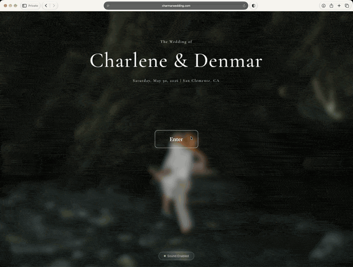
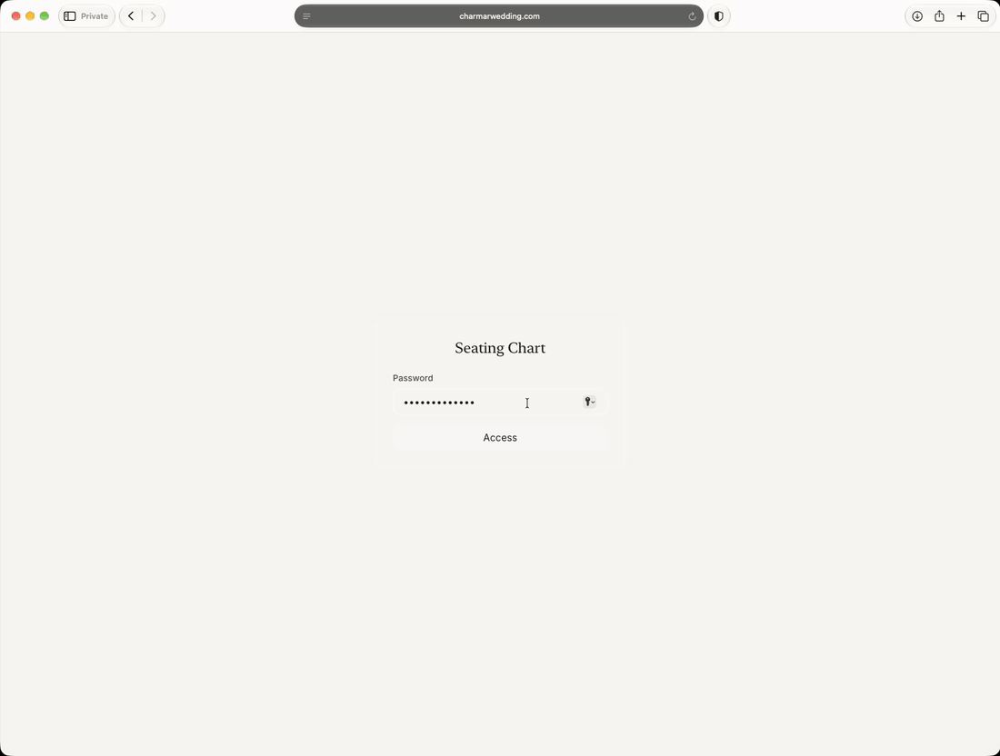
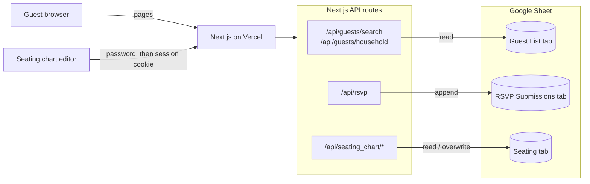

# Charlene & Denmar's Wedding Website

The website for our wedding on May 30, 2026 in San Clemente, CA. It handled everything guests needed before the day (our story, event details, FAQ, registry and RSVPs) plus a private seating chart editor we used to plan the reception.

**Live site:** https://wedding-site-ten-iota.vercel.app
(also at [charmarwedding.com](https://charmarwedding.com) until January 2027)



**By the numbers**
- **138** guests invited across **82** households
- **100%** of households RSVP'd through the site
- **121** guests attended

## Motivation

For the big day, I wanted to fully customize my own wedding website and do the web development that I sorely missed in my time as a Software Engineer at Amazon working in operating systems. I also took this as an opportunity to familiarize myself with public facing AI tools. I started with Vercel's v0 for the initial template, then used Kiro and Claude Code to get to the finish line.

Off-the-shelf wedding platforms also didn't fit how our guest list actually worked. Physical invitations went to households, not individuals. Building the website myself meant guests could find their invitation by name, RSVP for the people in their household, and give allergy and dietary details for each person.

Charlene and I both needed to manage the site. Rather than over-complicating things, I used Google Sheets as a database to easily manage the guest list and watch the RSVPs come in. The admin-facing seating chart I made also came in handy leading up to the big day, allowing us to iterate fast and conveniently print copies to give to the vendors.

## Features

**Guest site**
- Animated hero and "our story" timeline, with a Three.js background and an ambient audio track driven by the Web Audio API
- Event details with an embedded map and add-to-calendar (Google Calendar link or `.ics` download)
- FAQ and registry sections

**Household RSVP**
- Guests search by first name (last name optional). When several guests match, they pick their own invitation from the results.
- Whoever finds the invitation can RSVP for any member of their household
- Attending guests give allergies and dietary restrictions per person; declining skips those steps
- Each submission is appended as a row to a Google Sheet
- Details: [docs/HOUSEHOLD_RSVP_README.md](docs/HOUSEHOLD_RSVP_README.md)

**Seating chart editor** (`/seating_chart`, password protected)



- Floor plan of the venue with round and long tables
- Drag a guest onto another seat to swap them, or drag a table onto another table to swap everyone at once
- Undo/redo, a per-table summary, text export and print layout
- Saves to the same spreadsheet as the guest list
- Details: [docs/SEATING_CHART_SETUP.md](docs/SEATING_CHART_SETUP.md)

## Architecture



**Google Sheets as the database.** The guest list, RSVP responses and seating assignments all live in one spreadsheet. We could edit the guest list, watch RSVPs come in and tweak seating in a tool we already used, without me building an admin panel. The trade-off is that every read goes through the Sheets API, which is fast enough at this size.

**Guest data stays on the server.** The browser never gets the full guest list. API routes authenticate to Google with a service account, run the name search server-side and return only the matching household.

**Households come from the sheet layout.** The `Guest List` tab has first and last name columns, and a blank row separates households. The API groups consecutive rows into households and generates guest IDs from the names, so editing the guest list is just editing rows.

**Seating chart auth is enforced server-side.** `/api/seating_chart/verify` checks the password and sets an httpOnly cookie derived from it with an HMAC. The load and save routes reject requests without a valid cookie. The editor itself is a standalone HTML/JS page in `public/`, embedded in an iframe after login.

**Stack:** Next.js 16 (App Router), React 19, TypeScript, Tailwind CSS v4, shadcn/ui on Radix, Three.js and Vanta.js, GSAP, `googleapis`, Vercel (hosting and analytics)

```
app/
  page.tsx               # Single-page guest site
  seating_chart/         # Password gate + editor iframe
  api/
    guests/              # Name search and household lookup
    rsvp/                # RSVP submissions
    seating_chart/       # verify / load / save
components/              # Page sections and the multi-step RSVP form
lib/                     # Guest search, seating auth, calendar helpers
data/                    # Sample guest data
public/
  seating_chart_saved.html   # Seating chart editor
docs/                    # Setup guides
```

## Running locally

**Prerequisites:** Node 20+ and [Bun](https://bun.sh) (npm works too), plus a Google Cloud project if you want the RSVP and seating features.

```bash
bun install
cp .env.example .env.local
bun dev
```

The site runs at http://localhost:3000. Pages render without any environment variables, but guest lookup, RSVP and the seating chart need the Google Sheets setup below.

### Google Sheets setup

1. In Google Cloud Console, enable the **Google Sheets API** and create a **service account**. Download its JSON key.
2. Create a spreadsheet with three tabs:
   | Tab | Columns |
   | --- | --- |
   | `Guest List` | `First Name`, `Last Name` (blank row between households) |
   | `RSVP Submissions` | Leave empty; headers are added on the first submission |
   | `Seating` | `Table Number`, `Seat Index`, `Guest Name` |
3. Share the spreadsheet with the service account's email as an **Editor**.
4. Fill in `.env.local` (see below).

Full walkthroughs: [guest list](docs/GUEST_LIST_SETUP.md), [seating chart](docs/SEATING_CHART_SETUP.md).

### Environment variables

| Variable | Required for | Description |
| --- | --- | --- |
| `GOOGLE_SHEETS_CLIENT_EMAIL` | RSVP, seating | Service account email (`client_email` in the JSON key) |
| `GOOGLE_SHEETS_PRIVATE_KEY` | RSVP, seating | Service account private key (`private_key` in the JSON key). Keep the `\n` sequences and wrap it in quotes. |
| `GOOGLE_SHEETS_SPREADSHEET_ID` | RSVP, seating | The ID in the sheet's URL: `docs.google.com/spreadsheets/d/<ID>/edit` |
| `SEATING_CHART_PASSWORD` | Seating chart | Password for `/seating_chart` |
| `NEXT_PUBLIC_GOOGLE_MAPS_API_KEY` | Optional | Maps Embed API key. Without it, the venue map falls back to Google's keyless embed. |

### Configuration notes

- **RSVP window:** RSVPs are closed. To reopen them, set `RSVP_OPEN` in `app/api/rsvp/route.ts` and restore the button in `components/rsvp-section.tsx`.
- **Photo gallery:** an optional gallery backed by Google Cloud Storage is built but currently turned off. See [docs/GALLERY_GCS_SETUP.md](docs/GALLERY_GCS_SETUP.md).

## License

Code is shared for reference. Photos, audio and written content are personal and all rights reserved.
